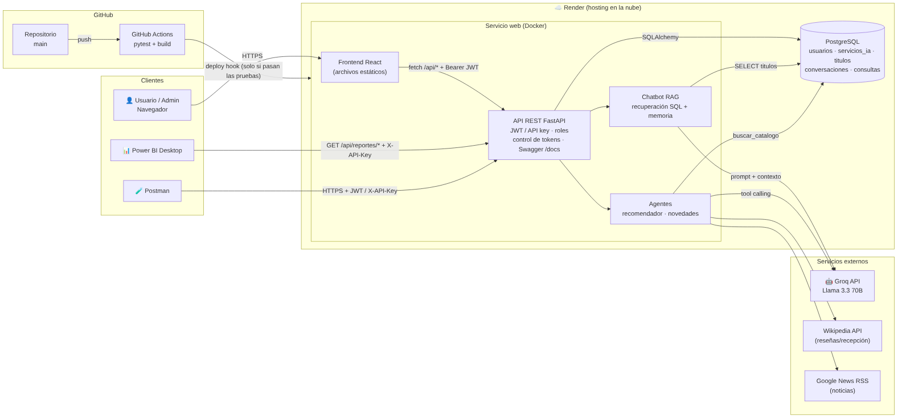
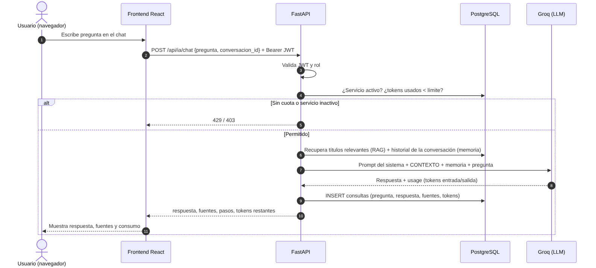
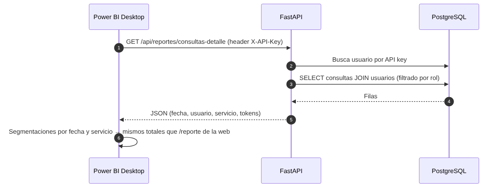
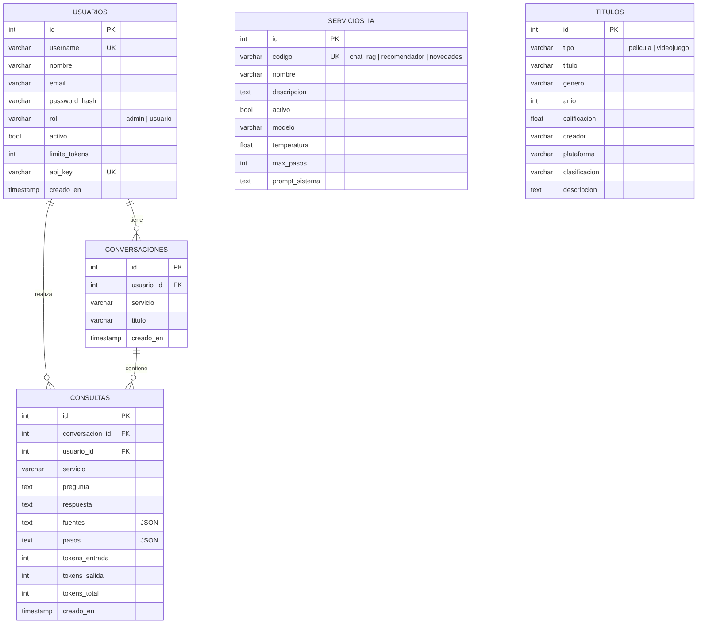

# CineGame AI — Propuesta, arquitectura y modelo de datos

**Curso:** Programación Comercial · **Estudiante:** Brayan Alexander, de León Pereira - 202308112

## 1. Propuesta

### Objetivo
Desarrollar una aplicación web que ayude a sus usuarios a descubrir, consultar y elegir películas y videojuegos
mediante tres servicios de Inteligencia Artificial: un chatbot que responde con base en un catálogo propio
almacenado en base de datos (RAG) y dos agentes que consultan fuentes externas en varios pasos para recomendar
títulos e informar novedades. La plataforma controla el consumo de tokens por usuario y expone sus servicios
mediante una API REST consumible desde otras aplicaciones y desde Power BI.

### Usuarios
| Rol | Necesidad | Funciones |
|---|---|---|
| Usuario | Consultar el catálogo, recibir recomendaciones y novedades | Chatbot, agentes, historial propio, consumo propio, reporte propio, API key |
| Administrador | Gestionar la plataforma y controlar costos | Todo lo anterior + CRUD de usuarios, límites de tokens, activar/desactivar y configurar servicios, CRUD del catálogo, reporte general |
| Consumidor externo | Integrar los servicios o analizar el uso | API REST con API key (Postman, Power BI) |

### Fuentes de información
| Fuente | Tipo | Uso |
|---|---|---|
| PostgreSQL, tabla `titulos` | Propia (administrada con CRUD) | Contexto del chatbot RAG y candidatos del recomendador |
| Wikipedia API (es/en) | Externa, pública | Resumen y recepción de la crítica (reseñas) |
| Google News RSS | Externa, pública | Noticias recientes de títulos y sagas |
| Groq (Llama 3.3 70B) | Proveedor de IA | Generación de respuestas y selección de herramientas (tool calling) |

### Servicios de IA
1. **Chatbot del catálogo (RAG).** Recupera de la BD los títulos relevantes a la pregunta (palabras clave
   normalizadas, filtro por tipo), los envía como contexto, cita cada título como `[#id]`, lista las fuentes y,
   si no hay datos, responde que no existe información suficiente. Mantiene memoria de los últimos 6
   intercambios de la conversación.
2. **Agente recomendador.** Identifica preferencias → busca candidatos en el catálogo (amplía filtros si hay
   pocos) → consulta reseñas de los mejores en Wikipedia → compara en una tabla → recomienda con fuentes.
3. **Agente de novedades.** Busca noticias del título o saga → si son pocas o no responden, amplía la búsqueda
   (saga, estudio, inglés, Wikipedia) → verifica si está en el catálogo → resume ordenado por fecha con fuentes.

En los agentes, el modelo decide qué herramienta usar en cada paso (*function calling*); la aplicación ejecuta la
herramienta, devuelve el resultado al modelo y repite hasta obtener la respuesta final (máximo configurable de
pasos). Los pasos y fuentes se muestran en la interfaz.

## 2. Arquitectura

| Componente | Tecnología | Hosting |
|---|---|---|
| Frontend | React 18 + Vite, React Router, Recharts | Render (servido por el mismo contenedor) |
| Backend / API | Python 3.12, FastAPI, SQLAlchemy, JWT, bcrypt | Render Web Service (Docker) |
| Base de datos | PostgreSQL 16 | Render PostgreSQL |
| IA | Groq API (compatible con OpenAI), Llama 3.3 70B | Nube de Groq |
| CI/CD | GitHub Actions (pytest + build → deploy hook) | GitHub |
| Reporte | Power BI Desktop (Web.Contents a la API) | Local |

**Comunicaciones:** todo por HTTPS. El navegador consume la API con `Authorization: Bearer <JWT>`; Postman y Power BI
con JWT o `X-API-Key`. La API se comunica con PostgreSQL mediante SQLAlchemy (psycopg) y con Groq, Wikipedia y
Google News mediante HTTP.

### Recorrido de una solicitud desde la GUI

### Recorrido de una solicitud desde Power BI

### Seguridad y control de consumo
- Contraseñas con bcrypt; sesiones con JWT (8 h); cierre de sesión elimina el token del cliente.
- Roles `admin` / `usuario`: los endpoints de administración usan la dependencia `require_admin`; las consultas de
  historial y reportes de un usuario se filtran siempre por su `id` aunque envíe otro `usuario_id`.
- Antes de llamar al modelo se verifica: servicio activo (si no, **403**) y `tokens_usados < limite_tokens`
  (si no, **429**). Los tokens se toman del campo `usage` que reporta el proveedor.

## 3. Modelo de datos

| Tabla | Descripción |
|---|---|
| `usuarios` | Cuentas, rol, estado, límite de tokens y API key |
| `servicios_ia` | Configuración de cada servicio: activo, modelo, temperatura, pasos máximos, prompt |
| `titulos` | Catálogo de películas y videojuegos (fuente del RAG) |
| `conversaciones` | Agrupa las consultas de una sesión de chat (memoria conversacional) |
| `consultas` | Registro automático de cada pregunta/respuesta con fuentes, pasos y tokens de entrada/salida |
| `v_consumo_diario` (vista) | Consumo agregado por fecha, usuario y servicio |

## 4. API REST (resumen)

| Método | Endpoint | Acceso | Descripción |
|---|---|---|---|
| POST | `/api/auth/login` | Público | Inicia sesión, devuelve JWT |
| POST | `/api/auth/logout` | Autenticado | Cierra sesión |
| POST | `/api/auth/api-key` | Autenticado | Genera API key para consumidores externos |
| POST | `/api/ia/chat` | Autenticado + cuota | Chatbot RAG con memoria |
| POST | `/api/ia/recomendador` | Autenticado + cuota | Agente recomendador |
| POST | `/api/ia/novedades` | Autenticado + cuota | Agente de novedades |
| GET | `/api/historial/conversaciones[/{id}]` | Autenticado | Conversaciones propias |
| GET | `/api/historial/consultas` | Autenticado | Historial (admin: todos, filtros usuario/fecha/servicio) |
| GET | `/api/consumo/me` | Autenticado | Consumo y tokens disponibles |
| GET | `/api/consumo/usuarios` | Admin | Consumo de todos los usuarios |
| GET | `/api/reportes/consumo` | Autenticado | Reporte por servicio y por día (filtros) |
| GET | `/api/reportes/consultas-detalle` | Autenticado | Filas planas para Power BI |
| GET/POST/PUT/DELETE | `/api/usuarios` | Admin | CRUD de usuarios y límites |
| GET/PUT | `/api/servicios` | Admin (PUT) | Activar/desactivar y configurar servicios |
| GET/POST/PUT/DELETE | `/api/catalogo` | Admin (escritura) | CRUD del catálogo |

Documentación interactiva: `/docs` (Swagger UI) y `/redoc`.

## 5. Pruebas automatizadas y CI/CD

20 pruebas con `pytest` (BD SQLite temporal y modelo simulado, sin llamadas externas):

- **Servicios de IA:** recuperación por género/tipo, envío del contexto al modelo, fuentes, indicación de información
  insuficiente, memoria conversacional, agente con varios pasos de herramientas, manejo de errores de herramientas.
- **Historial:** registro automático, historial propio vs. general, filtros por fecha/servicio, aislamiento entre usuarios.
- **Consumo de tokens:** cálculo acumulado, bloqueo (429) sin llamar al modelo, desbloqueo al ampliar el límite,
  servicio desactivado (403), coincidencia del reporte web con los datos para Power BI.
- **Seguridad/CRUD:** login, 401 sin token, 403 para no administradores, CRUD de usuarios y catálogo, API key.

Flujo `.github/workflows/ci-cd.yml`: en cada push a `main` → job **test** (pytest + build del frontend) →
job **deploy** (`needs: test`) que llama al deploy hook de Render y verifica `/api/health`. Si las pruebas fallan,
el despliegue no se ejecuta.

## 6. Enlaces
- Repositorio: `https://github.com/...`
- Aplicación: `https://cinegame-ai-....onrender.com`
- Swagger: `https://cinegame-ai-....onrender.com/docs`
